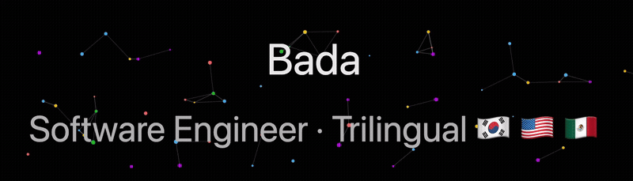

  

## 👋 About Me

**안녕하세요 🇰🇷, Hello 🇺🇸, Hola 🇲🇽 — 셋 다 저예요.**
*Thinking in Korean, coding in English, living in Spanish.*

- Everyone's digging for AI gold; I'd rather keep the mine from caving in. ⛏️
- Looking for a bigger arena — I want to see where my ceiling really is.
- "Alguien me dijo que cuando hablas español, te ves más feliz." 😊

## 🛠️ Tech Stacks

## 🚀 Projects

| Project | When | Description |
|---------|------|-------------|
| [**grimsup**](https://github.com/vamosbada/grimsup) | 2026.03~ | Art academy platform with real users — I own it end to end, incidents included. [See what broke and how I fixed it →](https://github.com/vamosbada/grimsup/blob/main/docs/incidents.md) · [grimsup.com](https://grimsup.com) 🎨 |
| [**project&#8209;puente**](https://github.com/vamosbada/project-puente) | 2025.05~12 | First-author paper (written in my 2nd year) on Spanish-English code-switching sentiment analysis — data relabeling beat every model change tried · KSC 2025 Honorable Mention&nbsp;🏆 |
| [**patron**](https://github.com/vamosbada/patron) | 2025.07~12 | Chart pattern similarity search — ResNet18 + Triplet Loss + FAISS over ~50k patterns, served via FastAPI 📈 |
| [**Zerothon**](https://github.com/vamosbada/TIL/tree/main/Projects/Zerothon-2025) | 2025.03 | AI-assisted team dashboard for a campus hackathon — led a team of five, built in four days · 2nd Place / Excellence Award 🥈 |

## 📫 Contact

